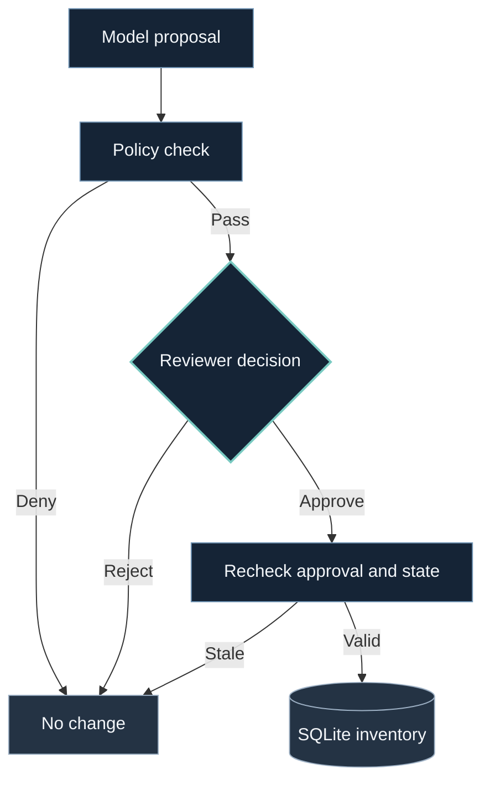
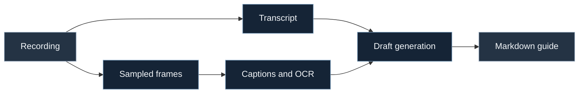

# Khalid IBNELBACHYR

**Cloud, Data & AI Services Lead · Solutions Architect · Strategy & Frontier Advisor**

I lead cloud, data and AI services in France. I came to that work through platform engineering, and I still like to start an architecture discussion with a concrete decision. Who can approve a change? Which costs can we defend? What evidence would make us reconsider a design?

## Selected engineering work

Three experimental, Apache-2.0 projects you can explore without cloud credentials.

| Project | Try it locally |
| --- | --- |
| **[Governed Agent Lab](https://github.com/kibnelbachyr/governed-agent-lab-public)** | Approve or reject a fictional storage-retention change, then inspect what the controller recorded. [Run the lab](https://github.com/kibnelbachyr/governed-agent-lab-public/blob/main/README.md#quickstart--no-credentials) |
| **[Azure Cost Intelligence](https://github.com/kibnelbachyr/azure-cost-intelligence)** | Give the evaluator fictional cost data and inspect how it handles overlapping savings estimates and missing prices. [Run the evaluation](https://github.com/kibnelbachyr/azure-cost-intelligence/blob/main/README.md#quickstart--evaluate-fictional-cost-data) |
| **[Video2Doc AI Community](https://github.com/kibnelbachyr/video2doc-ai-community)** | Generate a fictional Markdown guide with the mock CLI, or walk through the same workflow in a local browser. [Try the pipeline](https://github.com/kibnelbachyr/video2doc-ai-community/blob/main/README.md#quickstart--no-azure-credentials) |

## Inside two of the builds

### Governed Agent Lab · Who can change the resource?

A simulated model proposes a retention change. The controller checks policy before asking for a decision. On approval, it rechecks the evidence before updating the fictional inventory in SQLite.

### Video2Doc · What did the speaker say, and what was on screen?

A walkthrough can show a step the speaker never names. The pipeline brings speech and visual context together when drafting the guide. The offline demo supplies fictional inputs for both branches.

## Release evidence

| Experimental release | What the offline checks cover |
| --- | --- |
| [Governed Agent Lab v0.4.0](https://github.com/kibnelbachyr/governed-agent-lab-public/releases/tag/v0.4.0) | 51 unit tests per interpreter. The same 31 synthetic scenarios run three times on both Python 3.11 and 3.13. [Release CI](https://github.com/kibnelbachyr/governed-agent-lab-public/actions/runs/45909054667) |
| [Azure Cost Intelligence v0.1.0](https://github.com/kibnelbachyr/azure-cost-intelligence/releases/tag/v0.1.0) | 19 fictional scenarios, 57 executions and 507 checks against scripted responses. Realized savings and live model quality remain unmeasured. [Evaluation record](https://github.com/kibnelbachyr/azure-cost-intelligence/blob/main/docs/evidence/v0.1.0.md) |
| [Video2Doc AI Community v0.2.0](https://github.com/kibnelbachyr/video2doc-ai-community/releases/tag/v0.2.0) | 28 Python and 3 JavaScript tests. Coverage includes synthetic media processing and credential-free execution. Live transcription and generation quality remain unmeasured. [Release CI](https://github.com/kibnelbachyr/video2doc-ai-community/actions/runs/45911493736) |

## What I’m exploring

How incident diagnosis tools can show the evidence behind a proposed fix, how platform teams can delegate infrastructure changes safely, and where an LLM gateway should enforce cost and access decisions.

---

Personal projects and independent perspectives. Views are my own.
