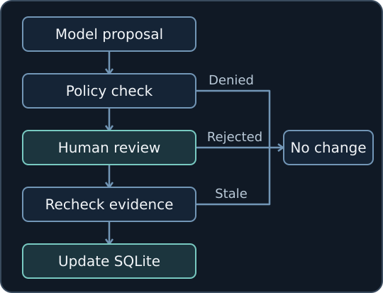
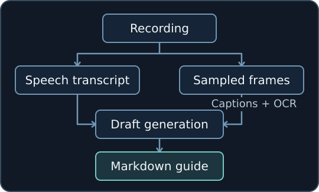

# Khalid IBNELBACHYR

**Cloud, Data & AI Services Lead · Solutions Architect · Strategy & Frontier Advisor**

I lead cloud, data and AI services in France. My background is in platform engineering. I’m interested in the decisions that make a system worth trusting: who can authorize a change, which cost estimates hold up, and what a test actually proves.

## Selected projects

Three experimental, Apache-2.0 releases. Each has a quickstart you can run without cloud credentials.

### Governed Agent Lab

Who can change a resource after an agent recommends it? Try approving a fictional storage-retention change, then rejecting it. The SQLite record shows what happened in each case.

[Run the lab](https://github.com/kibnelbachyr/governed-agent-lab-public/blob/main/README.md#quickstart--no-credentials) · [Release v0.4.0](https://github.com/kibnelbachyr/governed-agent-lab-public/releases/tag/v0.4.0)

### Azure Cost Intelligence

Two recommendations can claim savings on the same Azure resource. Run the evaluator on fictional cost data to see how it handles overlap, missing prices and estimates an owner still needs to validate.

[Run the FinOps evaluation](https://github.com/kibnelbachyr/azure-cost-intelligence/blob/main/README.md#quickstart--evaluate-fictional-cost-data) · [Release v0.1.0](https://github.com/kibnelbachyr/azure-cost-intelligence/releases/tag/v0.1.0)

### Video2Doc AI Community

A speaker can skip a step that’s visible on screen. Video2Doc combines a transcript with captions and on-screen text to draft a Markdown guide. The offline demo uses fictional inputs for both paths.

[Try the pipeline](https://github.com/kibnelbachyr/video2doc-ai-community/blob/main/README.md#quickstart--no-azure-credentials) · [Release v0.2.0](https://github.com/kibnelbachyr/video2doc-ai-community/releases/tag/v0.2.0)

## Offline release evidence

| Project | Verified coverage |
| --- | --- |
| [Agent Lab](https://github.com/kibnelbachyr/governed-agent-lab-public/actions/runs/45909054667) | 51 unit tests and 31 synthetic scenarios per Python version |
| [Azure Cost](https://github.com/kibnelbachyr/azure-cost-intelligence/blob/main/docs/evidence/v0.1.0.md) | 19 scenarios, 57 runs, 507 checks |
| [Video2Doc](https://github.com/kibnelbachyr/video2doc-ai-community/actions/runs/45911493736) | 28 Python tests and 3 JavaScript tests |

These checks exercise simulated approval, scripted cost responses and synthetic media. Live model quality and realized savings remain unmeasured.

## What I’m exploring

How incident tools can show the evidence behind a proposed fix, and where an LLM gateway should enforce access and cost controls.

---

Personal projects and independent perspectives. Views are my own.
